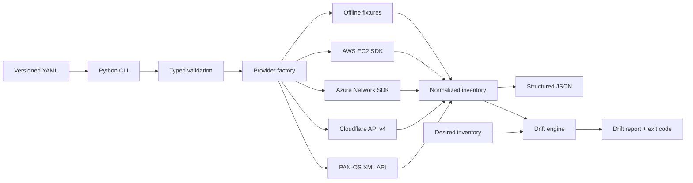

# Architecture

Adapters have one read-only contract: return normalized resources or raise an explicit provider error. Secret-bearing headers and API keys never enter output models. Deterministic sorting occurs after aggregation. The drift key is `provider/kind/id`; identity matches are then compared field-by-field.

